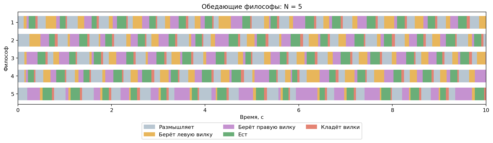
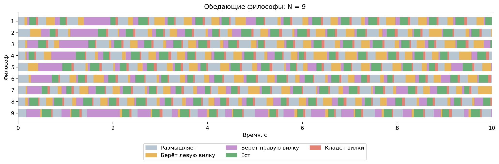

# Лабораторная работа №3

Задача об обедающих философах.

Я написал модель на Python. Каждый философ — отдельный поток threading.Thread,
каждая вилка — отдельная блокировка threading.Lock. По умолчанию за столом
пять философов, время работы — 10 секунд.

## Запуск

Из папки lab3:

~~~powershell
python philosophers.py --plot --output results/n5
~~~

Для диаграммы нужен matplotlib:

~~~powershell
python -m pip install matplotlib
~~~

Без параметра --plot программа работает на стандартной библиотеке Python.

Число философов и время можно изменить:

~~~powershell
python philosophers.py --count 9 --seconds 10 --plot --output results/n9
~~~

Минимальное число философов — 2. При двух участниках между ними находятся
две разные вилки. Seed задаётся параметром --seed; он фиксирует случайные
задержки каждого потока, но порядок работы потоков зависит от планировщика.
При повторном запуске в ту же папку результаты перезаписываются.

## Как работает модель

У философа i слева находится вилка i, справа — (i+1) % N. В коде нумерация
начинается с нуля, в журнале и на диаграмме — с единицы.

Все философы выполняют одну и ту же функцию philosopher. В ней повторяются
размышление, захват первой вилки, захват второй, еда и возвращение вилок.
Я задал случайные задержки:

| Действие | Время, с |
| --- | --- |
| Размышление | 0.10–0.25 |
| Взятие каждой вилки после захвата блокировки | 0.02–0.05 |
| Еда | 0.10–0.20 |
| Возвращение вилок | 0.02–0.05 |

Ожидание свободной вилки может занять дополнительное время.

Каждую вилку поток захватывает отдельным вызовом acquire. После захвата первой
вилки проходит время её взятия, и только потом поток пытается захватить вторую.
Поэтому обе вилки не блокируются одним действием. После еды философ освобождает
обе вилки подряд, без задержки между освобождениями.

### Почему нет взаимоблокировки

Я пронумеровал вилки. Каждый философ сначала берёт соседнюю вилку с меньшим
номером, потом — с большим. Последний философ поэтому сначала берёт правую,
остальные — левую. Правило и код для всех одинаковы.

Чтобы возникла взаимоблокировка, должна появиться замкнутая цепочка ожиданий.
В моей модели поток, держащий первую вилку, может ждать только вилку с большим
номером. Замкнуть такую цепочку невозможно: номера не могут бесконечно возрастать
по кругу.

Это устраняет взаимоблокировку. Строгую гарантию отсутствия голодания я не даю:
threading.Lock не обещает очередь по времени прихода. В проверенных запусках
все философы поели.

### Остановка

После подготовки всех потоков главный поток начинает отсчёт. Когда время
заканчивается, он устанавливает threading.Event. Потоки проверяют этот флаг,
а Event.wait позволяет прервать задержки. При ожидании вилки используется
acquire с тайм-аутом 0.01 с, чтобы поток тоже мог заметить остановку.

В finally каждый философ освобождает оставшиеся вилки, даже если успел взять
только одну. Главный поток вызывает join для всех потоков. Поэтому завершение
программы занимает чуть больше заданного времени.

GIL здесь не мешает моделированию: задача состоит из ожиданий и синхронизации,
а не из тяжёлых вычислений.

## Результаты

Программа сохраняет три файла в указанную папку:

- events.csv — последовательность изменений состояния;
- summary.txt — число завершённых приёмов пищи;
- timeline.png — временная диаграмма, если указан --plot.

В журнале ровно пять видов состояний:

1. Размышляет.
2. Берёт левую вилку.
3. Берёт правую вилку.
4. Ест.
5. Кладёт вилки.

«Берёт вилку» включает ожидание блокировки и время самого взятия.
В столбце held_forks указаны вилки, захват которых уже отражён в журнале.
Повторная запись того же состояния означает, например, что философ дождался
вилки и теперь держит её.

Для каждого философа состояние действует от времени записи включительно
до следующей его записи, не включая её время. Начальное состояние в момент
0 — «Размышляет». Последняя запись на границе заданного времени закрывает
интервал: это отметка конца наблюдения, а не новое действие.
Освобождение вилок при остановке выполняется после или на этой границе и
не добавляет шестого состояния.

Общий журнал защищён короткой блокировкой journal_lock, чтобы записи имели
однозначный порядок. Эта блокировка не удерживается во время ожидания вилок,
размышления или еды. Одновременно могут есть несколько несоседних философов.

Код и построение диаграммы находятся в одном файле philosophers.py.
Отдельных скриптов сборки и запуска нет.

## Проверка

Я проверил модель для N=2, 3, 5 и 8, а также остановку через 0.005 с.
По журналу проверил, что:

- соседние философы не едят одновременно;
- число едящих не превышает N // 2;
- одну вилку не держат два философа;
- перед едой у философа есть обе соседние вилки;
- после join все вилки освобождены;
- при остановке не остаётся работающих потоков.

При N=5 в проверочном запуске одновременно ели два философа. В запусках
длительностью 2.5 с для N=5 и N=8 каждый философ завершил хотя бы один приём
пищи. Числа при повторном запуске могут отличаться.

Для просмотра я также сохранил отдельные десятисекундные запуски:

| N | Завершённых приёмов пищи у каждого философа | Максимум едящих одновременно |
| --- | --- | --- |
| 5 | 15, 15, 15, 15, 15 | 2 |
| 9 | 15, 15, 15, 16, 15, 16, 16, 17, 15 | 4 |

Время вместе с завершением потоков составило 10.010 и 10.013 с соответственно.
Для этих двух запусков я также проверил сохранённые журналы: конфликтов
владения вилками и одновременной еды соседей нет.

