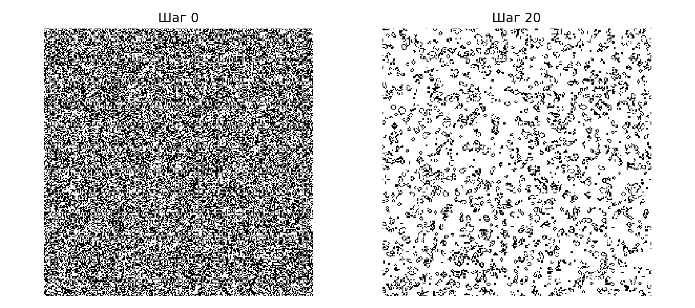
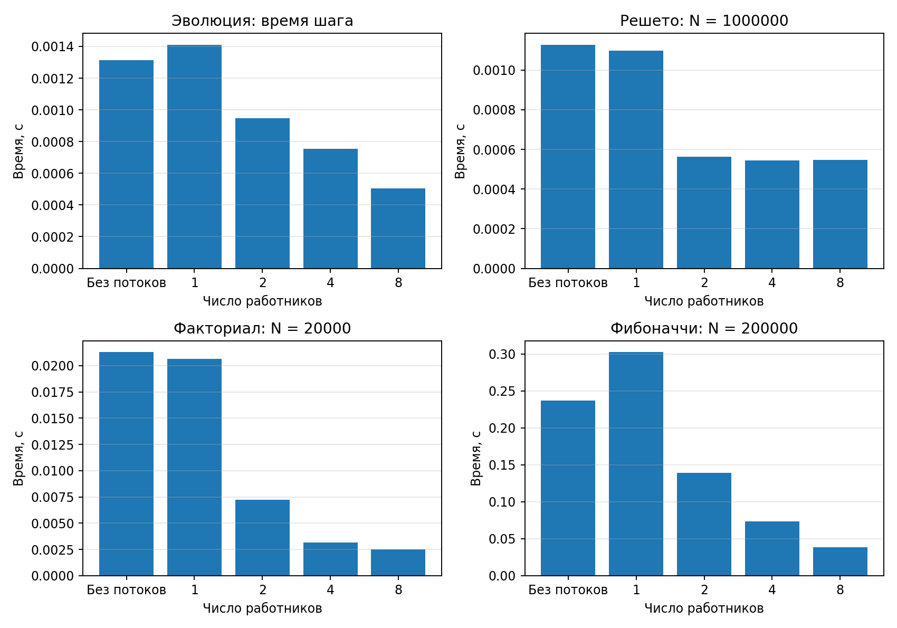

# Лабораторная №4: объяснение

Это учебный разбор для подготовки к очной сдаче. Отчёт на очной сдаче
не нужен: его отправляют преподавателю после сдачи.
Здесь важно понять, как идут вычисления, где работники ждут друг друга
и почему они не портят общие данные.

Начни с разделов «Что здесь изучается» и «Как читать конструкции Go».
Потом разбери задачу 1 по одному поколению и задачу 3 по одному вызову пула.
В конце есть порядок показа программы, картинки и вопросы для самопроверки.

## Что здесь изучается

В задаче 1 несколько работников совместно вычисляют одно поколение
клеточного поля. Следующий шаг зависит от предыдущего, поэтому нужно
согласовать границы шагов. Основное понятие — барьерная синхронизация.

В задаче 3 большое вычисление делится на независимые части.
Части исполняются работниками пула, затем их ответы объединяются.
Основные понятия — пул задач, разделение данных и сбор результата.

| Задача 1 | Задача 3 |
| --- | --- |
| Работник постоянно отвечает за свою полосу | Работник получает функцию из очереди |
| На каждом шаге обменивается строками | Во время вычисления части обмен не нужен |
| На каждом шаге проходит два барьера | После всех задач достаточно ожидания WaitGroup |
| Следующее поколение зависит от текущего | Части одного вычисления независимы |

«Работник» здесь — goroutine, выполняющая часть задачи.
Для правильной программы нужно определить, что каждый читает,
что изменяет и когда ждёт остальных.

Я выполнил задачи 1 и 3 в двух независимых модулях:

- task1/main.go — только эволюция, барьер и обмен границами;
- task3/main.go — только решето, факториал, Фибоначчи и пул.

У каждого файла свой main, свой запуск проверок и свои результаты.
Они не импортируют друг друга и запускаются отдельно. Здесь «модуль» —
отдельная программа в своей папке; дополнительных go.mod и пакетов нет.
Один plot.py строит рисунки по результатам двух программ.

## Запуск

Из папки lab4:

~~~powershell
go run task1/main.go -check
go run task1/main.go
go run task3/main.go -check
go run task3/main.go
python plot.py
~~~

Для рисунков нужен matplotlib: python -m pip install matplotlib.
Количество повторов можно изменить у каждого модуля:
go run task1/main.go -repeats 5 и go run task3/main.go -repeats 5.
Команды выполняются из lab4. Параметры каждой задачи заданы в её main.
Следующий запуск перезаписывает результаты только этой программы.
Если Go не найден, использую полный путь:

~~~powershell
& "C:\Program Files\Go\bin\go.exe" run task1/main.go -check
~~~

## Почему Go

В Go нет GIL. Конструкция go func запускает goroutine — лёгкого работника,
которого Go планирует на системных потоках. Это не отдельный процесс и
не работник, постоянно закреплённый за одним ядром.
GOMAXPROCS ограничивает количество системных потоков, одновременно
исполняющих Go-код. В сохранённом запуске он равен 16.

## Как читать конструкции Go

### Запуск работника

~~~go
go func(index int, rows field) {
    defer done.Done()
    // Работа с полосой.
}(i, rows)
~~~

func создаёт функцию, скобки (i, rows) вызывают её, go запускает вызов
в отдельной goroutine. Главная goroutine продолжает выполнять свой код.
Параметры index и rows принадлежат конкретному вызову.
defer done.Done() выполняется при выходе из функции, включая обычный return.

Горутины могут работать одновременно на разных ядрах, если позволяет
GOMAXPROCS. Число созданных goroutine может быть больше числа ядер.
Без синхронизации главный main мог бы завершиться раньше них.

### WaitGroup: ожидание завершения

~~~go
done.Add(1)
go func() {
    defer done.Done()
    // Вычисление.
}()
done.Wait()
~~~

Add увеличивает число незаконченных работников. Done уменьшает.
Wait блокирует вызывающего до обнуления счётчика.
Add вызывается до запуска работника, чтобы его завершение не опередило
регистрацию. WaitGroup не запирает массивы и не распределяет задачи.

### Каналы

~~~go
jobs := make(chan func())
jobs <- task
job := <-jobs
job()
~~~

chan func() — канал, передающий функции без аргументов и результата.
jobs <- task отправляет функцию, <-jobs получает её. Саму работу запускает job().
Поскольку канал jobs без буфера, отправитель ждёт, пока получатель примет
значение. Это не означает, что отправитель ждёт окончания job().

make(chan request, 2) создаёт канал с буфером на два запроса.
Пока есть место, отправитель может положить сообщение и продолжить.
Чтение пустого канала ждёт появления сообщения.

close(jobs) сообщает, что новых задач больше не будет.
Цикл for job := range jobs получает все оставшиеся задачи и завершается.
Отправлять в закрытый канал нельзя.

### Срезы и копии

~~~go
type field [][]byte
~~~

Это поле из строк, каждая строка — срез байтов.
Срез хранит описание участка памяти, а не все элементы внутри самого значения.
Простое присваивание rows := input не копирует клетки: обе переменные
ссылались бы на те же строки.

~~~go
append([]byte(nil), input[i]...)
~~~

Создаёт новую строку и копирует в неё элементы. Троеточие разворачивает
срез в последовательность элементов. Поэтому copyField — глубокая копия
для используемой двумерной структуры.

В nextStrip верхняя и нижняя принятые строки присоединяются к extended
без ещё одной копии. Это безопасно: в функции они только читаются,
а отправитель уже передал отдельные копии.

### Числа и указатели

*big.Int — указатель на большое целое. Встроенный int не вместит 20000!.
Cmp возвращает 0 при равенстве, отрицательное или положительное значение
при сравнении меньшего и большего.
Метод result.Mul(result, factor) изменяет result.
Нельзя одновременно изменять один big.Int из нескольких работников.

## Задача 1. Эволюция

Поле хранит 0 и 1. При трёх живых соседях клетка становится живой.
При двух сохраняется только уже живая клетка, в остальных случаях — пустая.
Читаются восемь позиций вокруг клетки.

Поле замкнуто в тор. Выражение (j+dj+width)%width переводит индекс,
вышедший за край, на противоположную сторону.
Последняя полоса соседствует с первой.

field — двумерный срез байтов. makeField заполняет его генератором с seed=1.
copyField копирует и строки, и данные в них, чтобы работники не изменяли
исходное поле.
nextStrip читает свою полосу и две принятые граничные строки.
Новое поколение записывается отдельно: иначе расчёт смешал бы старые
и уже обновлённые клетки.

### Разбиение и обмен

Пример: 10 строк и 3 работника.

| Работник | Свои строки | Верхняя граница нужна от | Нижняя граница нужна от |
| --- | --- | --- | --- |
| 0 | 0, 1, 2 | строка 9 у работника 2 | строка 3 у работника 1 |
| 1 | 3, 4, 5 | строка 2 у работника 0 | строка 6 у работника 2 |
| 2 | 6, 7, 8, 9 | строка 5 у работника 1 | строка 0 у работника 0 |

Внутри строки достаточно знать соседние столбцы. Для верхней или нижней
строки своей полосы данных уже не хватает — для этого и нужны запросы.

Работник i получает строки [i*height/workers, (i+1)*height/workers).
Части отличаются максимум на одну строку. Полная матрица ему не передаётся.

Перед каждым поколением он просит у предыдущего работника последнюю строку,
а у следующего — первую. request хранит флаг last и канал reply для ответа.
Затем работник обслуживает два встречных запроса и получает свои ответы.
В ответе передаётся копия строки.

Канал запросов имеет буфер 2: в него помещаются оба запроса соседей.
Канал ответа имеет буфер 1: ответ можно отправить до начала его чтения.
Поэтому все могут сначала отправить запросы, потом обслужить их.
При одном работнике оба запроса приходят самому себе, при двух — одному
соседу. Разные каналы ответов не дают перепутать границы.

Например, у работника 1 запрос предыдущему выглядит так:

~~~go
requests[0] <- request{true, topReply}
~~~

true означает «дай последнюю строку своей полосы».
topReply — канал, куда нужно прислать ответ.
Работник 0 получает запрос и выполняет:

~~~go
row := rows[len(rows)-1]
query.reply <- append([]byte(nil), row...)
~~~

Он читает только собственные строки. После получения ответа работник 1
использует присланную копию в nextStrip.
Для отправки первой строки используется last=false.

Никто не ждёт ответа, прежде чем отправить свои два запроса и обслужить
два встречных. Это важно: если бы все сразу ждали ответы, некому было бы
обслуживать запросы.

### Барьер

Мьютекс и барьер решают разные задачи:
мьютекс пускает одного в короткий участок, барьер собирает всех участников
на границе фазы. Внутри барьера мьютекс защищает только его счётчики,
а не всё вычисление поля.

Я реализовал повторно используемый барьер на sync.Cond:

- total — число участников;
- arrived — число пришедших;
- generation — номер фазы;
- condition — условная переменная с мьютексом.

wait захватывает мьютекс и увеличивает arrived. Последний участник
обнуляет счётчик, увеличивает generation и вызывает Broadcast.
Остальные ждут в цикле, пока номер поколения не поменяется.
Cond.Wait отпускает мьютекс на время ожидания и снова захватывает перед
возвратом. Проверять условие нужно в цикле.

Один шаг:

~~~text
запросы → ответы → новая полоса → барьер
→ копирование новой полосы в исходную → барьер → следующий шаг
~~~

Все выполняют одинаковое число шагов и барьеров. Главный поток
не входит в барьер; он ждёт завершения через WaitGroup.

Пример для трёх работников: первые два увеличивают arrived до 1 и 2
и засыпают в Wait. Третий видит arrived=3, меняет generation, обнуляет
arrived и вызывает Broadcast. Первые два просыпаются, видят смену фазы
и выходят. Следующий вызов того же барьера уже относится к новой фазе.

Локальная переменная generation запоминает фазу, в которую пришёл именно
этот участник. Без номера фазы быстрый работник мог бы уже прийти второй
раз, пока другие ещё выходят из первого ожидания.

Почему не просто один барьер? По условию нужно отделить вычисление
нового поколения от его копирования, а затем дождаться копирования.
Два вызова явно разделяют эти фазы. Каналы тоже вводят ожидания,
но не заменяют в этой реализации требуемый общий барьер.

Сами клетки не защищаются мьютексом: каждый работник пишет только свою
новую полосу. Чужие строки приходят копиями. Барьер согласует фазы,
а не защищает каждую запись по отдельности.

### В каком порядке показывать task1/main.go

1. makeField — начальное поле, одинаковое для всех запусков.
2. nextStrip — единственное место, где записаны правила клеточного автомата.
3. evolution — при workers=0 считает последовательно, иначе создаёт работников.
4. request и каналы — получение чужих строк у их владельцев.
5. barrier.wait — границы двух фаз каждого поколения.
6. check — проверки; main — параметры опыта, замеры и сохранение файлов.

results[i] записывает только работник i. После Wait главный поток соединяет
полосы в правильном порядке. Для чтения results дополнительный мьютекс
не нужен: все записи уже завершены.

## Задача 3. Пул

Важно различать задачу и работника. Задача — функция с одним куском работы.
Работник — goroutine, которая получает такие функции из канала.
Пул может выполнять много задач ограниченным числом работников.

pool создаёт workers goroutine. Они читают функции из jobs и выполняют их.
После отправки задач канал закрывается. range jobs заканчивается,
а WaitGroup ждёт окончания работников.
В этой работе задач столько же, сколько работников, но каждый работник
может последовательно выполнять и следующие задачи из очереди.

Задачи записывают результаты в разные элементы массива. Главный поток
читает их только после Wait. Работники не создают дочерних задач,
результата которых ждали бы в том же пуле.
В современном Go переменная for i := range tasks своя на каждой итерации,
поэтому замыкания получают правильные индексы.

tasks[i] = func() { ... } сохраняет функцию, но ещё не запускает её.
Она запоминает используемые переменные из окружающего кода — это замыкание.
Вызов pool создаёт работников и передаёт им сохранённые функции.

Нет гарантии, что каждый работник выполнит ровно одну задачу.
Если задача короткая, один может успеть забрать несколько.
Ограничено число goroutine, а не заранее закреплено соответствие
«задача i — работник i».

Пул создаётся заново для каждого вызова численного алгоритма.
Он не сохраняется между повторами измерений; запуск и закрытие входят во время.

## Решето

basePrimes строит простые до sqrt(N). Составное число имеет простой делитель,
не превосходящий квадратного корня.
Диапазон [2,N] делится на непересекающиеся сегменты.
sieveSegment вычёркивает кратные каждого базового простого p начиная с:

~~~text
max(p*p, ceil(start/p)*p)
~~~

Меньшие кратные уже вычеркнуты меньшими простыми.
Каждый работник изменяет собственный marked. Базовые простые общие,
но доступны только для чтения. Из локальных максимумов выбирается общий.
Пустой сегмент возвращает 0.

Пример решета до 30:

1. Базовые простые до sqrt(30) — 2, 3, 5.
2. Для 2 вычёркиваются 4, 6, 8, ..., 30.
3. Для 3 вычёркиваются 9, 12, 15, ..., 30.
4. Для 5 вычёркивается 25.
5. Последнее невычеркнутое число — 29.

Если сегмент начинается с 20, первое кратное 3 равно 21:
(20+3-1)/3*3 = 21 при целочисленном делении.
Смещение marked[k-start] переводит глобальное число в локальный индекс.

Почему достаточно простых до корня? Если N=a*b и оба множителя больше
sqrt(N), их произведение было бы больше N. Значит, у составного числа
есть делитель не больше корня; у него найдётся и простой делитель в этой границе.

Почему нужна проверка max(p*p, ...)? Она не даёт вычеркнуть само простое p,
если оно лежит в сегменте.

## Факториал

product перемножает числа полуинтервала [start,end).
Пул считает произведения частей, главный поток перемножает ответы.
Пустое произведение равно 1, поэтому 0!=1.

math/big.Int хранит точные целые произвольной длины.
Mul и Add изменяют получатель: поэтому у каждого работника свои big.Int.
После завершения их объединяет главный поток.

Пример 6! с двумя частями:

~~~text
задача 0: 1*2*3 = 6
задача 1: 4*5*6 = 120
главный поток: 6*120 = 720
~~~

product(1,4) включает 1,2,3; число 4 не входит.
Правая граница не включается, поэтому у соседних частей нет общего множителя.

parts хранит указатели на большие целые. Работник i присваивает только
parts[i]. После завершения пула главный поток уже один выполняет сборку.
Библиотечный MulRange используется только в проверке, сам factorial
написан через явный цикл product.

## Фибоначчи

F(0)=0, F(1)=1. fibPair возвращает (F(n),F(n+1)) обычным циклом:

~~~go
a, b := big.NewInt(0), big.NewInt(1)
for i := 0; i < n; i++ {
    next := new(big.Int).Add(a, b)
    a, b = b, next
}
~~~

Перед итерацией a=F(i), b=F(i+1). После сложения next=F(i+2),
а присваивание передвигает пару на одну позицию.
При n=0 тело не выполняется и возвращается (0,1).
Здесь n сложений; их стоимость увеличивается с длиной чисел.

Индекс N делится на длины m1+...+mp=N. Каждый работник вычисляет пару
для своей длины. Для пар (a,b)=(F(k),F(k+1)) и (c,d)=(F(m),F(m+1)):

~~~text
F(k+m) = a*d+(b-a)*c
F(k+m+1) = b*d+a*c
~~~

nextA и nextB создаются до замены a и b, поскольку старые значения нужны
обеим формулам.

Например, N=10 и два работника: каждый считает пару (F(5),F(6))=(5,8).
Главный поток объединяет её с (0,1), затем со второй такой же парой:
F(10)=5*8+(8-5)*5=55. Просто складывать F(5)+F(5) нельзя.

Число работников больше N допустимо: часть длин будет нулевой.
fibPair(0)=(0,1); объединение такой пары не меняет накопленный результат.

Откуда формула объединения? Для последовательности Фибоначчи действует
тождество F(k+m)=F(k)*F(m+1)+F(k-1)*F(m).
При k>=1 можно заменить F(k-1) на F(k+1)-F(k)=b-a.
Вторая формула — F(k+m+1)=F(k+1)*F(m+1)+F(k)*F(m).
Начальная накопленная пара (0,1) также корректно работает в этих выражениях:
при объединении с (c,d) она просто даёт (c,d).

Здесь делится индекс, а не само число и не его десятичная запись.
Все промежуточные значения точные; округлений вещественной арифметики нет.

### В каком порядке показывать task3/main.go

1. pool — общая очередь функций и фиксированное число работников.
2. basePrimes, sieveSegment, largestPrime — три части решета.
3. product и factorial — частичные произведения и общий ответ.
4. fibPair и fibonacci — обычный цикл и объединение пар.
5. check — независимые небольшие примеры.
6. measure — только повторение замера, проверка и запись CSV.
7. main — три вызова measure с параметрами задач.

measure принимает функцию calculate, чтобы не копировать один и тот же
код таймера три раза. Решето возвращает int, поэтому в main его ответ
оборачивается в big.NewInt; факториал и Фибоначчи уже возвращают big.Int.
Это нужно только для единого сравнения ответов в measure.

## Проверки и время

В task1 флаг -check проверяет осциллятор через границу тора, несколько
поколений, нулевое число шагов и неравномерные полосы.
В task3 он проверяет малые границы решета, 0! и 1!,
первые 101 число Фибоначчи.
Эталоны — перебор делителей, big.Int.MulRange и цикл сложений.

Для эволюции последовательный ответ проверяет согласованность разбиений,
а осциллятор с заранее заданным ответом отдельно проверяет правило и тор.
Одинаковые результаты двух реализаций сами по себе не исключают общую ошибку,
поэтому полезны и такие маленькие примеры с известным результатом.

В task3 проверка Фибоначчи сравнивает ответы с простым циклом сложений.
После упрощения fibPair это та же рекуррентная формула; проверка прежде всего
проверяет разбиение индекса и объединение пар, а не независимый способ
вычисления самой последовательности.

Основной запуск: три повтора без работников (p=0) и с p=1,2,4,8.
Параметры: поле 256×256, 20 шагов, решето до 1000000, 20000!, F(200000).
Каждый ответ сравнивается с последовательным после остановки таймера.
В замер входят вычисление, создание и закрытие работников, обмен и сбор ответа.
Сравнение, компиляция, исходные эталоны, запись файлов и рисование исключены.
Полное среднее время эволюции делится на 20.

results/task1.csv и task3.csv — отдельные измерения,
task1.txt и task3.txt — параметры и компактные результаты,
fields.json — два поля для рисования.
[]byte при записи JSON кодировался бы в base64, поэтому строки поля
преобразуются в массивы int.

Ускорение факториала зависит не только от параллельности, но и от
размеров промежуточных произведений.
В Фибоначчи части считают более короткие последовательности и работают
с меньшими целыми, но при объединении добавляются умножения.
Так что параллельная и последовательная версии делают разный набор
арифметических операций. На короткие замеры также влияют прогрев,
частоты процессора, фоновая нагрузка и сборка мусора.

### Как читать main и служебные функции

В каждой программе main сначала разбирает флаги:

~~~go
repeats := flag.Int("repeats", 3, "measurements per configuration")
onlyCheck := flag.Bool("check", false, "check task 1")
flag.Parse()
~~~

flag.Int и flag.Bool возвращают указатели. Поэтому *repeats — само
число повторов, *onlyCheck — булево значение флага.
Если передан -check, вызывается check и main заканчивается через return,
не выполняя замеры и не перезаписывая их результаты.

При обычном запуске для каждой конфигурации:

~~~go
started := time.Now()
answer := evolution(initial, steps, workers)
total += time.Since(started).Seconds()
~~~

Измеряется только вызов вычисления. Затем отдельно сравнивается answer
с expected. После повторов total делится на их количество.
В задаче 1 полученное полное время дополнительно делится на steps.

workers=0 — выбранное в этой программе обозначение последовательного режима:
нет создания работников. workers=1 уже запускает одного работника
с обменом и синхронизацией либо с пулом. Поэтому режимы 0 и 1 различаются.

must проверяет ошибки открытия и записи файлов и останавливает программу
через panic при ошибке. Это служебная обработка ошибок, не алгоритм задачи.
fmt.Printf печатает результат. csv.Writer сохраняет числовую таблицу,
Flush выталкивает накопленный буфер в файл.
saveJSON в задаче 1 сохраняет поля для рисунка.
summary содержит компактные сведения о запуске.

В main задачи 3 функция measure получает разные calculate:
решето, факториал или Фибоначчи. Сначала вызывает calculate(0) для эталона,
потом делает три измерения для каждого числа работников.
Служебная measure не распределяет числа между задачами — это делают
largestPrime, factorial и fibonacci.

### Что делает plot.py

Скрипт не участвует в многопоточном решении.
Он читает обе таблицы и fields.json, затем через pyplot создаёт два PNG.
Он не запускает Go и сам не измеряет время.
Если перезапустить один Go-модуль, соответствующая таблица обновится,
но рисунок останется прежним до повторного python plot.py.

## Что делать на очной сдаче

Отчёт не открываю: он предназначен для отправки после очной сдачи.
Для демонстрации достаточно исходников, запуска проверок, результатов
и при необходимости рисунков.

Из каталога lab4:

~~~powershell
# Первая задача: проверка, затем измерения.
go run task1/main.go -check
go run task1/main.go

# Третья задача: проверка, затем измерения.
go run task3/main.go -check
go run task3/main.go

# Обновить рисунки после новых измерений.
python plot.py
~~~

Если нужно показать программы по отдельности, можно остановиться после
запуска соответствующего модуля. Второй для его вычислений не нужен.
Для общего рисунка времени нужны результаты обоих модулей.

Сначала кратко объясняю смысл задачи, затем показываю основную функцию
и места синхронизации. Только после этого — таймер и сохранение файлов.

Для задачи 1 порядок рассказа:

1. Что такое клетка, соседи и тор.
2. Почему новое поколение считается отдельно.
3. Какая полоса достаётся работнику.
4. Как он запрашивает строки и отвечает соседям.
5. Что разделяют два барьера.
6. Почему можно собрать результат после WaitGroup.

Для задачи 3:

1. Как устроен общий пул.
2. Как делятся сегменты решета и почему записи не конфликтуют.
3. Как делятся множители факториала.
4. Почему для Фибоначчи считаются пары и как они объединяются.
5. Какие ответы получены и как они проверялись.

## Какие картинки показывать и что они означают

В условии задачи 1 сказано внести результат сравнения времени в отчёт,
для задачи 3 — сравнить время разных конфигураций.
Отдельной обязательной картинки именно для очной сдачи в условии нет.
Но два уже созданных рисунка удобно показать как результаты программы.
Они не заменяют объяснение синхронизации и проверки правильности.

### 1. Поле до и после моделирования

Файл: [images/lab4_evolution.png](images/lab4_evolution.png).

Слева шаг 0, справа шаг 20 для поля 256×256. Чёрная клетка живая,
белая пустая. Оба состояния относятся к одному и тому же начальному полю.

Что говорить: «Каждое новое поколение строится по старому целиком.
Поле замкнуто в тор. Потоковый результат совпал с последовательным».

По одной этой картинке нельзя доказать ни правильность всех клеток,
ни использование барьера. Это проверяется кодом и тестами.
Картинка показывает именно изменение состояния модели.

### 2. Сравнение времени

Файл: [images/lab4_times.png](images/lab4_times.png).

Здесь четыре диаграммы:

| Диаграмма | Что измерено |
| --- | --- |
| Слева сверху | Среднее время одного поколения эволюции |
| Справа сверху | Время поиска наибольшего простого до 1000000 |
| Слева снизу | Время вычисления 20000! |
| Справа снизу | Время вычисления F(200000) |

По горизонтали: последовательный режим, затем 1, 2, 4 и 8 работников.
По вертикали: секунды. Чем ниже столбик, тем меньше время.
Столбики разных диаграмм имеют разные масштабы; сравнивать их высоту
между диаграммами без чтения оси нельзя.

В сохранённых данных, например:

- шаг эволюции: около 0.001315 с без работников и 0.000504 с при 8;
- факториал: около 0.021309 с без работников и 0.002494 с при 8;
- Фибоначчи: около 0.236811 с без работников и 0.038514 с при 8.

Это средние трёх запусков, а не минимально возможные времена.
При новом запуске они изменятся.
Разбиение больших чисел меняет также стоимость арифметики, поэтому
ускорение больше числа работников не означает ошибку таймера само по себе
и не доказывает идеальную загрузку ядер.

Открыть рисунки в Windows можно так:

~~~powershell
Invoke-Item .\images\lab4_evolution.png
Invoke-Item .\images\lab4_times.png
~~~

images/emblem.png — общая эмблема титульного листа, уже используемая в отчётах.
На очной сдаче для демонстрации алгоритмов она не нужна.

## Вопросы для самопроверки

Попробуй ответить самостоятельно, затем сверься с пояснением.

**Почему нельзя менять старое поле сразу?**
Следующая клетка увидит смесь поколений, и результат станет зависеть
от порядка обхода и расписания работников.

**Чем барьер отличается от мьютекса и WaitGroup?**
Мьютекс защищает короткий общий участок, барьер согласует фазы между
участниками, WaitGroup дожидается завершения всей работы.

**Почему Cond.Wait вызывается в цикле?**
После пробуждения нужно проверить условие своей фазы. Сам факт пробуждения
не заменяет проверку generation.

**Что будет, если один работник не придёт на барьер?**
Остальные останутся ждать. Поэтому все выполняют одинаковое число шагов.
Нельзя произвольно выходить из рабочего цикла одного участника.

**Читает ли работник чужое поле?**
Нет. Он отправляет запрос владельцу и получает копию граничной строки.

**Почему нет блокировки на каждый элемент решета?**
Потому что задачи изменяют непересекающиеся локальные массивы.
Общие базовые простые никто не меняет.

**Где главный поток ждёт результаты пула?**
В done.Wait внутри pool. После возврата pool массив ответов уже заполнен.

**Почему нельзя сложить ответы частей Фибоначчи?**
F(k+m) не равно F(k)+F(m). Нужна пара соседних значений и формула
сложения индексов.

**Что означает число в summary с пометкой bits?**
Битовую длину точного большого целого, а не округлённый ответ.
Сами результаты проверяются полным сравнением Cmp.

**Почему один работник может оказаться медленнее режима без работников?**
Он добавляет каналы, запуск goroutine, ожидания и закрытие пула,
но не добавляет вычислительных ресурсов относительно последовательного режима.

**Почему Go, а не Python?**
У Go нет GIL, поэтому вычислительные goroutine могут одновременно
исполняться на нескольких ядрах. Это не гарантирует ускорения любой задачи:
остаются обмены, сборка мусора и стоимость запуска.

## Короткое объяснение своими словами

Для задачи 1:

> Я разделяю поле по строкам. Каждый работник считает только свою полосу,
> а недостающие соседние строки запрашивает у их владельцев через каналы.
> Новое поколение сначала записывается отдельно. Один барьер ждёт окончания
> вычисления, второй — копирования нового поколения в исходное.
> Поэтому следующий шаг использует согласованное состояние всего поля.

Для задачи 3:

> Я создал пул, где фиксированное число работников получает функции из канала.
> В решете каждый вычёркивает свой сегмент, в факториале считает произведение
> своего отрезка. Для Фибоначчи считаются пары соседних чисел для частей
> индекса, затем они объединяются по формуле. Главный поток ждёт весь пул,
> собирает ответ и сравнивает его с последовательным.

Это опорные формулировки. На сдаче за каждым предложением нужно уметь
показать соответствующее место в коде.

## После очной сдачи

Отчёт находится отдельно в report.tex. Для его компиляции в Overleaf
нужны этот файл и images. Этот DEFENSE.md отправлять преподавателю
как отчёт не нужно.
